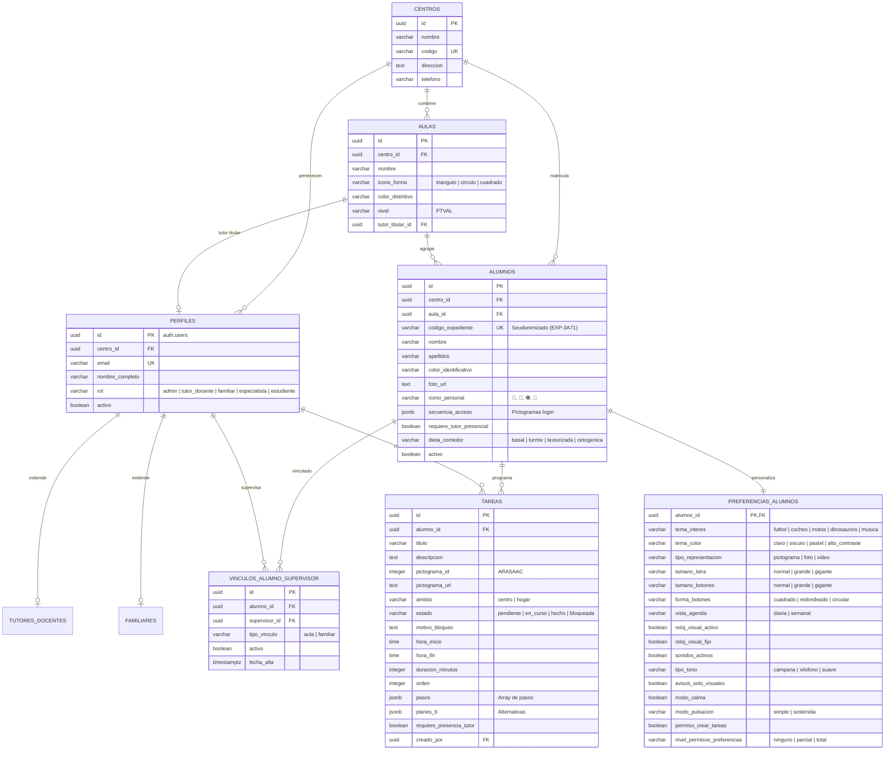

# Supabase BaaS - Esquema Relacional SQL y Políticas RLS

**Proyecto:** AGENSIBLE (TuAgendita)  
**Organización:** CEE Fundación Purísima Concepción de Granada  
**Subgrupo 2:** Los Gantt-sters (UGR · Curso 2026-2027)  
**Responsable Base de Datos:** Germán Delgado Fernández  
**Tarea / Criterio:** SCRUM-156 (T-T01.2 / HUT-01), CA-T01.2  
**Alineación:** Prototipo Oficial (`tuagendita-prototipos (1).html`), RGPD, LOPDGDD, WCAG 2.1 AA  

---

## 1. Resumen de la Arquitectura de Datos

El backend de **AGENSIBLE** se apoya en **Supabase** sobre **PostgreSQL 16**. El esquema de datos está estructurado según los requisitos de las asignaturas DGP/MDA y el prototipo funcional:

1. **Privacidad y RGPD:**
   - Estudiantes identificados por código de expediente seudonimizado (`codigo_expediente`, ej. `EXP-3A71`).
   - Fotos táctiles de rostro y secuencias de 3 pictogramas para login accesible sin contraseña ni exposición de datos sensibles.
2. **Segregación Estricta de Ámbitos (Escolar vs Hogar):**
   - El **tutor familiar** solo tiene visibilidad sobre tareas domésticas (`ambito = 'hogar'`) de su propio hijo.
   - El **tutor docente** solo gestiona tareas del centro escolar (`ambito = 'centro'`) de su aula asignada.
   - Las políticas RLS de PostgreSQL impiden cualquier fuga de datos incluso si se intentan consultas directas por API.
3. **Personalización Cognitiva y Temas Favoritos (Centros de Interés):**
   - El alumno cuenta con un campo **`tema_interes`** (fútbol, coches, motos, dinosaurios, música, animales...) para personalizar la interfaz, reforzar su motivación y tematizar sus recompensas visuales.
   - Preferencias sensoriales completas: tamaño de letra, tamaño y forma de botones, temas de alto contraste, modo calma, modo de pulsación motriz (simple o sostenida de 1.5s), sonidos y reloj Time Timer.

---

## 2. Diagrama Entidad-Relación (ER)

---

## 3. Explicación de Cada Tabla

### 1. `centros`
Guarda el centro educativo (`CEE Fundación Purísima Concepción`). Permite multitenencia si en el futuro se amplía a otros centros.

### 2. `aulas`
Representa las clases del PTVAL (Programa de Transición a la Vida Adulta y Laboral). En el prototipo se identifican visualmente por formas y colores:
- **Aula Triángulo (🔺)**
- **Aula Círculo (🔵)**
- **Aula Cuadrado (🟩)**
Cada aula tiene asignado un tutor titular docente.

### 3. `perfiles`
Extensión de la tabla de autenticación `auth.users` de Supabase. Guarda el rol del usuario:
- `admin`: Gestión global del centro.
- `tutor_docente`: Profesores de aula y especialistas PT/AL.
- `familiar`: Padres o tutores legales.
- `estudiante`: Cuenta del alumno en tableta.

### 4. `tutores_docentes` y `familiares`
Tablas de especialización según el rol:
- `tutores_docentes` guarda su aula asignada y especialidad pedagógica.
- `familiares` guarda el parentesco y teléfonos de urgencia.

### 5. `alumnos`
Ficha del estudiante adaptada a Educación Especial y RGPD:
- `codigo_expediente`: Identificador seudonimizado (ej. `EXP-3A71`).
- `foto_url`: Fotografía táctil de rostro para que el alumno pulse sobre su cara al iniciar sesión.
- `icono_personal`: Emoji/pictograma distintivo de su taquilla/mesa (`🦁`, `🐢`, `🚗`, etc.).
- `secuencia_acceso`: 3 pictogramas elegidos en orden para login visual sin contraseña.
- `requiere_tutor_presencial`: Etiqueta destacada en pantalla para alumnos con gran dependencia.
- `dieta_comedor`: Tipo de dieta (`basal`, `túrmix`, `texturizada`, `cetogénica`).

### 6. `vinculos_alumno_supervisor`
Relación muchos a muchos entre alumnos y supervisores.
- Tipo `aula`: Vincula al alumno con su profesor/a de clase.
- Tipo `familiar`: Vincula al alumno con su familia.
- **Regla de negocio:** Un índice único asegura que cada alumno solo tiene un tutor familiar activo principal.

### 7. `preferencias_alumnos`
Configuración sensorial y de accesibilidad individualizada:
- **`tema_interes`**: **Centro de interés del alumno (fútbol, coches, motos, dinosaurios, música...)** para reforzar la motivación visual y contextualizar refuerzos.
- `tema_color`: Paletas accesible (`claro`, `oscuro`, `pastel`, `alto_contraste`).
- `tamano_letra` y `tamano_botones`: `normal`, `grande`, `gigante` (≥64px táctil).
- `modo_pulsacion`: `simple` o `sostenida` (requiere pulsar 1.5s para evitar errores de pulso).
- `modo_calma`: Atenúa estímulos y simplifica la pantalla ante crisis de sobrecarga sensorial.
- `reloj_visual_activo`: Time Timer regresivo visual en rojo.

### 8. `tareas`
Actividades de la agenda estructurada ("Hecho - Ahora - Después"):
- `ambito`: **`centro`** o **`hogar`**. Permite que la familia gestione rutinas de casa y el colegio las lectivas sin interferir entre sí.
- `estado`: `pendiente`, `en_curso`, `hecho`, `bloqueada` (ej. si llueve y toca huerto).
- `pasos`: Pasos encadenados para tareas complejas (ej. lavarse las manos: 1. grifo, 2. jabón, 3. frotar, 4. aclarar, 5. toalla).
- `planes_b`: Alternativas automáticas si la tarea se bloquea.
