# Supabase BaaS - Esquema Relacional SQL y Políticas RLS (Modelo Oficial v2)

**Proyecto:** AGENSIBLE (TuAgendita)  
**Organización:** CEE Fundación Purísima Concepción de Granada  
**Subgrupo 2:** Los Gantt-sters (UGR · Curso 2026-2027)  
**Responsable Base de Datos:** Germán Delgado Fernández  
**Tarea / Criterio:** SCRUM-156 (T-T01.2 / HUT-01), CA-T01.2  
**Alineación Oficial:** Documentación Docente `profeV2-1.pdf` (Sección 5: Base de Datos) y **Figura 3: Modelo conceptual de datos de Agensible con soporte para persistencia plurianual**, RGPD, LOPDGDD, WCAG 2.1 AA  

---

## 1. Resumen de la Arquitectura de Datos y Ciclo de Vida Plurianual

El backend de **AGENSIBLE** está implementado sobre **Supabase (PostgreSQL 16)**. Tras la revisión exhaustiva con el profesorado de la asignatura y la consolidación de la documentación formal (`profeV2-1.pdf`), el esquema de datos aborda de forma integral tanto los aspectos operativos diarios como las garantías críticas de persistencia plurianual y privacidad:

1. **Gestión del Ciclo de Vida Escolar y Persistencia Anual (Secc. 5.1.1):**
   - Incorporación de la entidad **`cursos_lectivos`** (`2026-2027`, etc.). Todas las matrículas, asignaciones de aula, tareas lectivas y vínculos quedan estrictamente contextualizadas temporalmente.
   - **Procedimiento de Cierre Anual:** Permite al administrador finalizar un curso escolar desacoplando automáticamente las aulas de los estudiantes sin destruir sus historiales ni sus perfiles sensoriales.
   - **Histórico de Matrículas (`historico_matriculas`):** Conserva la trazabilidad curricular de promociones y rotaciones entre aulas (p. ej. paso de PTVAL 1 a PTVAL 2) manteniendo la inmutabilidad de los registros académicos pasados.

2. **Privacidad, RGPD y Retención de Datos (Secc. 5.1.3):**
   - **Seudonimización estricta:** Alumnos referenciados por `codigo_expediente` (ej. `EXP-3A71`).
   - **Procedimiento de Archivado por Egreso/Baja (`archivar_estudiante_rgpd`):** Al concluir su etapa en el centro, se disocian de inmediato datos faciales (fotografía táctil) y nombre completo, reteniendo únicamente el identificador opaco para estadísticas pedagógicas agregadas.
   - **Purga de telemetría a 12 meses (`purgar_telemetria_antigua`):** Ejecuciones diarias y grabaciones circunstanciales se purgan automáticamente cumpliendo el principio de limitación del plazo de conservación.

3. **Separación entre Catálogo Maestro de Tareas y Asignaciones Diarias (Figura 3):**
   - **`tareas`**: Catálogo reutilizable con título en lectura fácil, pictogramas ARASAAC, ámbito (`centro` o `hogar`), prioridad, duración estimada, días aplicables, desglose en `pasos_tarea`, `recursos_multimedia` y **Plan B asociado** (tarea alternativa si se bloquea la principal).
   - **Subtipos de Encargos del Centro:** Soporte específico para tareas vocacionales del PTVAL: *reprografía*, *comedor*, *reparto de menús* y *visitas/embajador QR*.
   - **`asignaciones`**: Planificación de una tarea concreta para un estudiante en una fecha y franja horaria determinada de un curso lectivo.

4. **Telemetría y Marcas de Tiempo Reales (OE13, SCRUM-76, Secc. 5.2.1):**
   - **`ejecuciones`**: Registra la marca de tiempo exacta de inicio real (`inicio_real`) al pulsar «Empezar» y de fin real (`fin_real`) al pulsar «Terminar», calculando la duración real y la desviación frente a la estimación prevista.
   - Almacena el array de pasos confirmados con sus marcas de tiempo y el **feedback emocional (3 caritas)** para evaluar la adaptación cognitiva del alumno.

5. **Eventos en Tiempo Real / Auxilio (HU-18 / SCRUM-85):**
   - **`avisos_peticiones`**: Gestión reactiva mediante WebSockets de necesidades fisiológicas básicas (baño, agua, descanso) y botón de auxilio/urgencia con localización de sala actual.

---

## 2. Diagrama Entidad-Relación (Alineado 100% con Figura 3)

```mermaid
erDiagram
    CURSOS_LECTIVOS ||--o{ AULAS : enmarca
    CURSOS_LECTIVOS ||--o{ ALUMNOS : matricula
    CURSOS_LECTIVOS ||--o{ HISTORICO_MATRICULAS : registra
    CURSOS_LECTIVOS ||--o{ ASIGNACIONES : contextualiza

    CENTROS ||--o{ AULAS : contiene
    CENTROS ||--o{ PERFILES : pertenecen
    CENTROS ||--o{ ALUMNOS : escolariza

    AULAS ||--o{ ALUMNOS : agrupa
    AULAS ||--o| PERFILES : "tutor titular"
    
    PERFILES ||--o| TUTORES_DOCENTES : especializa
    PERFILES ||--o| FAMILIARES : especializa

    ALUMNOS ||--o{ HISTORICO_MATRICULAS : historial
    ALUMNOS ||--o{ VINCULOS_ALUMNO_SUPERVISOR : vincula
    PERFILES ||--o{ VINCULOS_ALUMNO_SUPERVISOR : supervisa
    ALUMNOS ||--|| PREFERENCIAS_ALUMNOS : personaliza

    TAREAS ||--o| TAREAS : "Plan B alternativo"
    TAREAS ||--o{ PASOS_TAREA : desglosa
    PASOS_TAREA ||--o{ RECURSOS_MULTIMEDIA : ilustra

    ALUMNOS ||--o{ ASIGNACIONES : planifica
    TAREAS ||--o{ ASIGNACIONES : programa
    ASIGNACIONES ||--o| EJECUCIONES : monitoriza

    ALUMNOS ||--o{ AVISOS_PETICIONES : solicita
    PERFILES ||--o{ AVISOS_PETICIONES : atiende

    CURSOS_LECTIVOS {
        uuid id PK
        varchar anio_escolar UK "2026-2027"
        date fecha_inicio
        date fecha_fin
        boolean activo
        boolean cerrado
        timestamptz fecha_cierre
    }

    AULAS {
        uuid id PK
        uuid centro_id FK
        uuid curso_lectivo_id FK
        varchar nombre "Aula Triángulo"
        varchar icono_forma "triangulo, circulo, cuadrado"
        varchar color_distintivo
        varchar nivel "PTVAL"
        uuid tutor_titular_id FK
    }

    PERFILES {
        uuid id PK "auth.users"
        uuid centro_id FK
        varchar email UK
        varchar nombre_completo
        varchar rol "admin, tutor_docente, familiar, especialista, estudiante"
        boolean activo
    }

    ALUMNOS {
        uuid id PK
        uuid centro_id FK
        uuid aula_id FK
        uuid curso_lectivo_id FK
        varchar codigo_expediente UK "EXP-3A71"
        varchar nombre
        varchar apellidos
        date fecha_nacimiento
        varchar estado "activo, promocionado, egresado, archivado"
        varchar metodo_acceso "visual, pin, usuario_password"
        text foto_url "Login visual"
        varchar icono_personal "⭐, ⚽, 🚗, 🦖"
        jsonb secuencia_acceso "3 pictogramas"
        boolean requiere_tutor_presencial
        varchar dieta_comedor "basal, turmix, texturizada, cetogenica"
        boolean activo
    }

    HISTORICO_MATRICULAS {
        uuid id PK
        uuid alumno_id FK
        uuid aula_id FK
        uuid curso_lectivo_id FK
        date fecha_inicio
        date fecha_fin
        varchar estado "activa, promocionada, historica"
    }

    VINCULOS_ALUMNO_SUPERVISOR {
        uuid id PK
        uuid alumno_id FK
        uuid supervisor_id FK
        uuid curso_lectivo_id FK
        varchar tipo_vinculo "aula, familiar, especialista_pt"
        boolean activo
        timestamptz fecha_alta
        timestamptz fecha_baja
    }

    PREFERENCIAS_ALUMNOS {
        uuid alumno_id PK, FK
        varchar tema_interes "futbol, coches, dinosaurios, musica"
        varchar paleta "claro, oscuro, pastel, alto_contraste"
        varchar letra "normal, grande, gigante"
        varchar botones "normal, grande, gigante"
        varchar forma_botones "cuadrado, redondeado, circular"
        varchar reloj "time_timer"
        boolean reloj_visual_activo
        boolean sonidos_activos
        varchar avisos "combinado, visual, sonoro"
        varchar foco "borde_azul, amarillo_grueso"
        boolean modo_calma
        varchar modo_pulsacion "simple, mantener (1.5s)"
    }

    TAREAS {
        uuid id PK
        uuid alumno_id FK "opcional si es catálogo común"
        varchar titulo
        text descripcion "Lectura fácil"
        varchar tipo "rutina, encargo, pedagogica, ocio, personal"
        varchar subtipo "reprografia, comedor, reparto_menu, visita, general"
        integer pictograma_id "ARASAAC"
        text pictograma_url
        varchar ambito "centro, hogar"
        varchar prioridad "baja, media, alta, urgente"
        uuid plan_b_tarea_id FK "Plan B alternativo"
        integer duracion_estimada_minutos
        jsonb dias_semana
        boolean requiere_presencia_tutor
    }

    PASOS_TAREA {
        uuid id PK
        uuid tarea_id FK
        integer orden
        varchar texto
        text imagen_url
        text audio_url
        text video_url
    }

    RECURSOS_MULTIMEDIA {
        uuid id PK
        uuid paso_id FK
        varchar tipo "imagen, audio, video, pictograma"
        text archivo_url
        text descripcion_alternativa
        varchar origen "arasaac, propio, grabacion"
    }

    ASIGNACIONES {
        uuid id PK
        uuid estudiante_id FK
        uuid tarea_id FK
        uuid curso_lectivo_id FK
        date fecha
        time hora_inicio
        time hora_fin
        integer orden
        varchar estado "pendiente, en_curso, completada, bloqueada, cancelada"
        boolean plan_b_activado
    }

    EJECUCIONES {
        uuid id PK
        uuid asignacion_id UK, FK
        uuid estudiante_id FK
        timestamptz inicio "inicio_real"
        timestamptz fin "fin_real"
        integer duracion_real_segundos
        integer desviacion_segundos
        varchar estado_final "completada, bloqueada, cancelada"
        jsonb pasos_confirmados
        varchar valoracion_emocional "contento, neutral, triste"
        text observaciones
    }

    AVISOS_PETICIONES {
        uuid id PK
        uuid estudiante_id FK
        varchar necesidad "bano, agua, descanso, urgencia, ayuda"
        boolean urgencia
        varchar sala_actual
        boolean atendido
        uuid atendido_por_id FK
        timestamptz atendido_en
    }
```

---

## 3. Catálogo Descriptivo de Entidades y Campos

| Entidad | Descripción y Atributos Clave | Persistencia / Ciclo de Vida |
|---|---|---|
| **`cursos_lectivos`** | Identifica el año escolar (ej: `2026-2027`), fechas oficiales de inicio/cierre e indicador de curso activo. Solo puede existir un curso activo simultáneamente. | Permanente (histórico de cursos). |
| **`centros`** | Centro educativo de referencia (`CEE Fundación Purísima Concepción`). | Permanente (multitenencia). |
| **`aulas`** | Clases del PTVAL identificadas por pictogramas geométricos (Triángulo 🔺, Círculo 🔵, Cuadrado 🟩). Vinculadas a su tutor docente titular y curso lectivo. | Anual / Por curso escolar. |
| **`perfiles`** | Extensión de `auth.users` de Supabase con nombre, email cifrado, rol (`admin`, `tutor_docente`, `familiar`, `estudiante`) y estado. | Permanente (cuentas de acceso). |
| **`alumnos`** | Ficha del estudiante con `codigo_expediente` seudonimizado, fotografía táctil para login visual, secuencia de 3 pictogramas, estado (`activo`, `promocionado`, `egresado`, `archivado`) y etiqueta obligatoria de tutor. | Permanente hasta baja/purga RGPD. |
| **`historico_matriculas`** | Registra los cambios de aula y promociones de cada alumno entre distintos cursos académicos para auditoría pedagógica. | Permanente histórico. |
| **`vinculos_alumno_supervisor`** | Conecta alumnos con docentes y familiares. Regla estricta: un alumno tiene un tutor de aula y un único tutor familiar activo principal. | Por curso escolar o permanente (familia). |
| **`preferencias_alumnos`** | Configuración sensorial individualizada: centro de interés favorito (`tema_interes`), tamaño de letra/botones, Time Timer visual, modo calma y pulsación sostenida (1.5s). | Permanente vinculada al estudiante. |
| **`tareas`** | Catálogo reutilizable de actividades. Incluye encargos del centro (`reprografia`, `comedor`, `reparto_menu`, `visita`), duración estimada, desglose y Plan B asociado. | Permanente (catálogo maestro). |
| **`pasos_tarea`** y **`recursos_multimedia`** | Secuencia ordenada de pasos multimedia con imágenes, pictogramas ARASAAC, audios explicativos o vídeos de apoyo. | Permanente asociado a la tarea. |
| **`asignaciones`** | Planificación concreta de una tarea a un estudiante en un día y hora específicos de un curso lectivo. | Anual con archivo automático. |
| **`ejecuciones`** | Telemetría y marcas de tiempo reales (`inicio_real`, `fin_real`, duración, desviación, pasos completados y 3 caritas emocionales). | Depuración tras 12 meses (archivo agregado). |
| **`avisos_peticiones`** | Eventos en tiempo real mediante WebSockets: botón permanente de baño, agua, descanso o auxilio con sala actual. | Telemetría operativa (30 días). |

---

## 4. Garantías de Seguridad y Segregación Lógica (RLS)

Alineado con la **Sección 5.3 de `profeV2-1.pdf`**:
- **Tutores Familiares:** Únicamente tienen concedido permiso `SELECT` y modificación sobre los datos de su hijo directo y en las tareas de su ámbito doméstico (`ambito = 'hogar'`).
- **Tutores Docentes:** Acceso exclusivo a los alumnos inscritos en su aula en el curso lectivo en vigor y a las tareas del centro escolar (`ambito = 'centro'`).
- **Inmutabilidad de Cursos Cerrados:** Cuando un curso lectivo se cierra formalmente, los permisos de modificación sobre tablas históricas se revocan a nivel de base de datos.
- **Administradores:** Control integral para auditoría y asignación inicial de roles.
